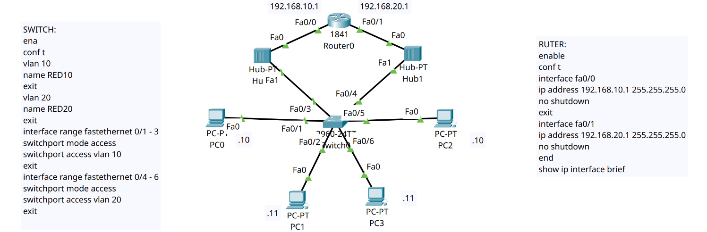
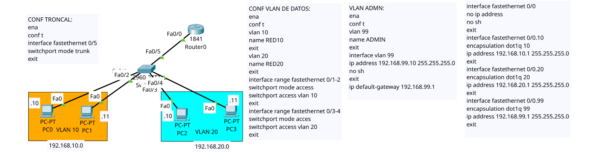

# Laboratorios de redes

En este repositorio documento mis prácticas de CCNA 2 en Cisco Packet Tracer. Incluyo las topologías, las configuraciones y las pruebas que uso para entender cómo viaja el tráfico por la red.

## Laboratorio 01 · Enrutamiento entre VLAN

¿Cómo puede PC0, que pertenece a la VLAN 10, comunicarse con PC2, que pertenece a la VLAN 20? Implementé dos formas de conectar el switch al router para resolver el mismo problema.

| Método | Conexión entre el switch y el router | Cómo distingue el router cada VLAN |
|---|---|---|
| [1 · Enlaces de acceso](./01-enrutamiento-entre-vlan/metodo-1-enlaces-de-acceso/) | Dos enlaces físicos, uno por VLAN | Por la interfaz física que recibe la trama |
| [2 · Enlace troncal](./01-enrutamiento-entre-vlan/metodo-2-enlace-troncal/) | Un enlace compartido por las VLAN | Por la etiqueta 802.1Q asociada a cada subinterfaz |

### Método 1 · Dos enlaces de acceso

Configuré `Fa0/3` del switch como puerto de acceso para la VLAN 10 y `Fa0/4` para la VLAN 20. En el router asigné `192.168.10.1` a `Fa0/0` y `192.168.20.1` a `Fa0/1`. Cada PC usa como puerta de enlace la dirección del router que pertenece a su subred.

Comprobé la comunicación con un ping de PC0 a PC2. Al revisar la tabla de rutas, entendí por qué funcionaba: el router ya conocía ambas subredes porque estaban directamente conectadas.

[Ver archivo de Packet Tracer del método 1](./01-enrutamiento-entre-vlan/metodo-1-enlaces-de-acceso/metodo-1-enlaces-de-acceso.pkt)

### Método 2 · Un enlace troncal (router-on-a-stick)

Conecté `Fa0/5` del switch a `Fa0/0` del router mediante un enlace troncal. Dejé la interfaz física del router activa y sin IP, y configuré tres subinterfaces:

| VLAN | Subinterfaz | Puerta de enlace |
|---|---|---|
| 10 · RED10 | `Fa0/0.10` | `192.168.10.1` |
| 20 · RED20 | `Fa0/0.20` | `192.168.20.1` |
| 99 · ADMIN | `Fa0/0.99` | `192.168.99.1` |

Para el tráfico de PC0 a PC2, el switch envía la trama al router con la etiqueta de la VLAN 10. El router consulta la IP de destino y devuelve el paquete por el mismo cable, en una trama con etiqueta de la VLAN 20. También asigné `192.168.99.10` al switch para administrarlo desde la VLAN 99.

[Ver archivos del método 2](./01-enrutamiento-entre-vlan/metodo-2-enlace-troncal/)

